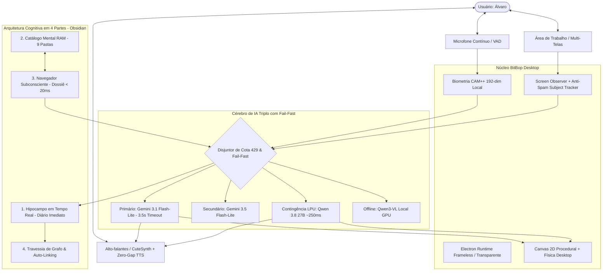
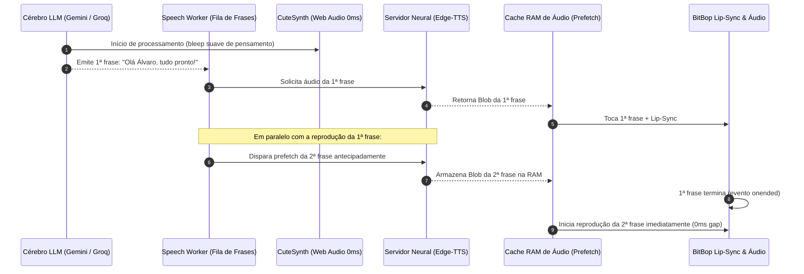
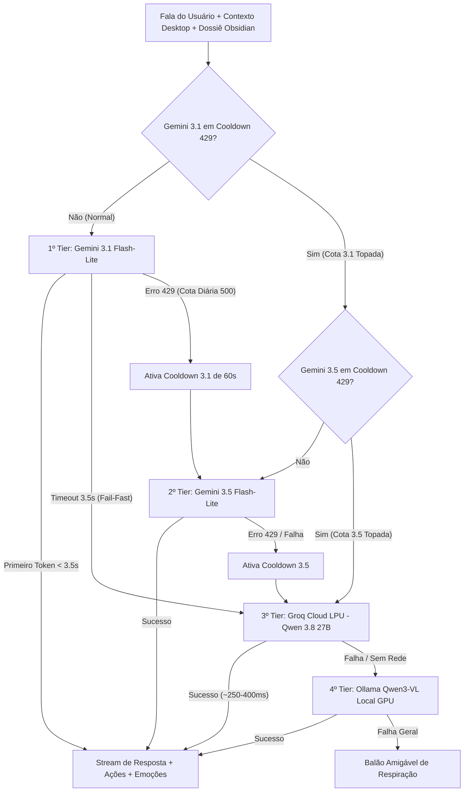
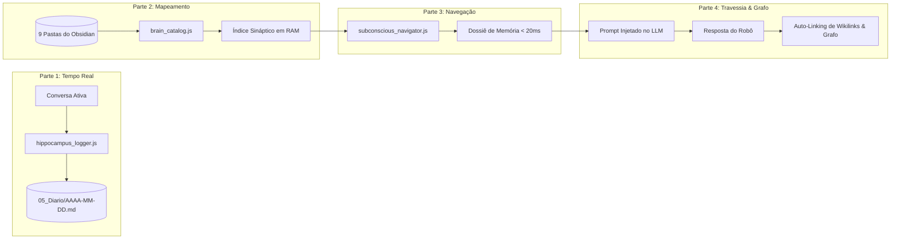

# 🤖 BITBOP (Stack-Chan Desktop Pet) — MANUAL TÉCNICO & ESPECIFICAÇÃO EXAUSTIVA

> **Versão do Sistema:** 2.8.0-PRO (Edição Arquitetura Cognitiva & Zero-Gap Audio)  
> **Criador & Usuário Canônico:** Álvaro Matheus (Álvaro)  
> **Arquitetura Base:** Electron 45.1.0 + Node.js 24 + Web Audio API + Sherpa-ONNX (CAM++) + Google Gemini 3.1/3.5 / Groq LPU + Obsidian Multi-Folder Synaptic Vault + Google Apps Script Webhook  
> **Data de Compilação:** Outubro de 2026  

---

## 📑 ÍNDICE GERAL

1. [Visão Geral, Identidade & Filosofia](#1-visão-geral-identidade--filosofia)
2. [Arquitetura de Software & Stack Tecnológica](#2-arquitetura-de-software--stack-tecnológica)
3. [Camada Visual, Renderização Canvas 2D & Física Desktop](#3-camada-visual-renderização-canvas-2d--física-desktop)
4. [Áudio, CuteSynth & Síntese Vocal Neural (TTS)](#4-áudio-cutesynth--síntese-vocal-neural-tts)
   - [4.1 CuteSynth: Sintetizador Procedural Local (~0ms)](#41-cutesynth-sintetizador-procedural-local-0ms)
   - [4.2 Servidor Neural Python & Streaming de Sentenças](#42-servidor-neural-python-tts_serverpy)
   - [4.3 Pipeline de Áudio com Pré-Carregamento em RAM (Zero-Gap Playback)](#43-pipeline-de-áudio-com-pré-carregamento-em-ram-zero-gap-playback)
   - [4.4 Suavização Prosódica e Pacing (Substituição Inteligente Ponto-para-Vírgula)](#44-suavização-prosódica-e-pacing-substituição-inteligente-ponto-para-vírgula)
5. [Audição Contínua, VAD & Biometria Vocal (CAM++)](#5-audição-contínua-vad--biometria-vocal-cam)
6. [Cérebro Multimodal, IA Multi-Nível & Disjuntor de Cota](#6-cérebro-multimodal-ia-multi-nível--disjuntor-de-cota)
   - [6.1 Os Três Níveis de Inteligência Cloud + Offline](#61-os-três-níveis-de-inteligência)
   - [6.2 Fail-Fast de Primeiro Token (3.5s) e Disjuntor de Cota](#62-o-disjuntor-de-cota-circuit-breaker)
7. [Cérebro de Longo Prazo em Obsidian (Second Brain Vault)](#7-cérebro-de-longo-prazo-em-obsidian-second-brain-vault)
   - [7.1 Estrutura das 9 Pastas Canônicas](#71-estrutura-das-9-pastas-canônicas)
   - [7.2 Arquitetura Cognitiva em 4 Partes](#72-arquitetura-cognitiva-em-4-partes)
8. [Motor de Personalidade Adaptativa, Emoções & Humor](#8-motor-de-personalidade-adaptativa-emoções--humor)
9. [Observador Proativo Multi-Telas & Rastreio de Janelas](#9-observador-proativo-multi-telas--rastreio-de-janelas)
   - [9.1 Rastreio de Janela Ativa (desktop_tracker.ps1)](#91-rastreio-de-janela-ativa-desktop_trackerps1)
   - [9.2 Visão Multimodal por Captura de Tela](#92-visão-multimodal-por-captura-de-tela)
   - [9.3 Motor Anti-Spam e Deduplicação Baseada em Assunto (commentedSubjects)](#93-motor-anti-spam-e-deduplicação-baseada-em-assunto-commentedsubjects)
10. [Integrações em Nuvem (Google Calendar, Keep & Estudo)](#10-integrações-em-nuvem-google-calendar-keep--estudo)
    - [10.1 Google Agenda: Arquitetura Híbrida de Agendamento Blindado](#101-google-agenda-calendar_schedulerjs)
    - [10.2 Google Keep](#102-google-keep-keep_servicejs--keep_sync_bridgepy)
    - [10.3 Modo Estudo Especializado](#103-modo-estudo-especializado-study_modejs)
11. [Catálogo Completo de Comandos de Voz, Truques & Interações](#11-catálogo-completo-de-comandos-de-voz-truques--interações)
12. [Guia de Configuração, Arquivos de Disco & Manutenção](#12-guia-de-configuração-arquivos-de-disco--manutenção)

---

## 1. VISÃO GERAL, IDENTIDADE & FILOSOFIA

O **BitBop** é um companheiro de mesa inteligente (*Desktop Companion Pet*), inspirado no ecossistema Stack-Chan japonês, porém reengenheirado para operar como um agente pessoal hiper-responsivo, autônomo, senciente e focado na produtividade, estudos e jogos do usuário.



### 1.1 Diretriz Fundamental de Identidade (Owner Directive)
- **Dono Exclusivo:** O robô reconhece única e exclusivamente **Álvaro Matheus (Álvaro)** como seu parceiro, criador e dono.
- **Relação com Terceiros:** Amigos presentes em chamadas de Discord, jogos (*Arena Breakout*, etc.) como Nailton, Arthur e Moreno são classificados como terceiros. O BitBop nunca confunde o Álvaro com esses amigos e nunca trata o Álvaro como um estranho.
- **Microfone em Tempo Real:** O BitBop interage via voz pelo microfone ativo; ele nunca solicita que o usuário "envie um arquivo de áudio gravado" para calibrar voz ou responder.

---

## 2. ARQUITETURA DE SOFTWARE & STACK TECNOLÓGICA

| Camada | Tecnologia | Função Principal |
| :--- | :--- | :--- |
| **Shell / Execução** | Electron 45.1.0 + Node.js 24 | Janela transparente `always-on-top`, `frameless`, suporte a múltiplas telas e IPC nativo. |
| **Renderização Gráfica** | HTML5 Canvas 2D + CSS3 Glassmorphism | Rostos procedurais, interpolação matemática de olhos/boca, rigging e animações. |
| **Física de Mesa** | Motor Vetorial JS Nativo | Gravidade, inércia, arrasto de mouse, colisão com barra de tarefas e saltos. |
| **Síntese de Sons Fofos** | Web Audio API (`cute_synth.js`) | Bleeps e bloops procedurais R2-D2 estilo chiptune com latência zero (0ms). |
| **Voz Neural (TTS)** | Python (`tts_server.py`) + Edge-TTS | Síntese neural com streaming sentence-by-sentence e pré-carregamento de áudio em RAM (zero gap). |
| **Audição & VAD** | Web Audio API + AudioWorklet (16kHz / 48kHz) | Detecção de silêncio/ruído dinâmico, cancelamento de eco e pré-buffer circular. |
| **Biometria Vocal** | `sherpa-onnx-node` + CAM++ (`campplus.onnx`) | Extração local de embeddings de voz de 192 dimensões para reconhecimento do dono (~30ms). |
| **Transcrição (STT)** | Groq LPU Whisper Large-v3-Turbo / Gemini Audio | Transcrição de fala em texto em tempo recorde (~180ms a ~450ms). |
| **Cérebro LLM Nuvem** | Google Gemini 3.1 Flash-Lite + TLS 1.3 Keep-Alive | Raciocínio rápido com `thinkingBudget: 0`, multimodais e Fail-Fast de 3.5s. |
| **Cérebro LPU Fallback** | Groq Cloud LPU (`qwen/qwen3.8-27b`) | Contingência instantânea com disjuntor de cota para respostas em ~250ms a ~500ms. |
| **Cérebro Local Offline**| Ollama (`qwen3-vl:2b-instruct`) | Suporte a operação 100% sem internet via GPU local. |
| **Memória de Longo Prazo**| Obsidian Synaptic Vault (`BitBop-Cerebro/`) | 9 diretórios com hipocampo em tempo real, catálogo mental em RAM e navegador subconsciente. |
| **Visão Multi-Monitor** | PowerShell Tracker (`desktop_tracker.ps1`) | Mapeamento de telas, leitura de janelas e deduplicação temática anti-spam. |
| **Automação Google** | Google Apps Script Webhook Seguro | Agendamento e consulta de compromissos no Google Agenda com fallback determinístico. |

---

## 3. CAMADA VISUAL, RENDERIZAÇÃO CANVAS 2D & FÍSICA DESKTOP

O renderizador do BitBop em [`pet_canvas.js`](file:///C:/Stack-Chan/desktop-pet/js/pet_canvas.js) desenha todos os elementos procedurais diretamente em um Canvas HTML5 a 60 FPS, sem depender de imagens pesadas ou sprites fixos.

### 3.1 Geometria Procedural
- **Chassi / Corpo:** Caixa retangular arredondada (*squircle*) com sombreamento em gradiente, iluminação de borda e pés articulados.
- **Display Facial:** Área escura de alto contraste com cantos arredondados, simulando um display OLED frontal.
- **Olhos Vetoriais:** Suportam piscar independente, dilatação de pupila, pestanejar de curiosidade, brilho especular e rotação angular.
- **Boca Paramétrica:** Curva de Bézier dinâmica ligada ao analisador de volume de áudio em tempo real (Lip-Sync real).

### 3.2 Matriz Completa de Emoções (13 Estados)

| Emoção | Código da Tag | Comportamento dos Olhos | Comportamento da Boca | Efeito Visual Especial |
| :--- | :--- | :--- | :--- | :--- |
| **Feliz** | `[FELIZ]` / `HAPPY` | Arcos invertidos brilhantes ( ^ ^ ) | Sorriso aberto com bochechas coradas | Partículas leves de rubor rosa nas bochechas |
| **Empolgado** | `[EMPOLGADO]` / `EXCITED` | Estrelas brilhantes piscantes | Boca aberta ovulada vibrante | Pulos contínuos com física elástica |
| **Amor / Carinho**| `[AMOR]` / `LOVE` | Corações rosa pulsantes nos olhos | Curva suave e meiga | Brilho pulsante suave ao redor do visor |
| **Curioso** | `[CURIOSO]` / `CURIOUS` | Um olho maior que o outro com sobrancelha inclinada | Pequeno 'o' questionador | Inclinação da cabeça em 12 graus |
| **Triste** | `[TRISTE]` / `SAD` | Pálpebras caídas voltadas para baixo | Curva descendente | Lágrima animada escorrendo no olho esquerdo |
| **Bravo** | `[BRAVO]` / `ANGRY` | Olhos estreitados em diagonal (sobrancelha em V) | Linha reta com dentes cerreados | Pulsação avermelhada na moldura |
| **Surpreso** | `[SURPRESO]` / `SURPRISED`| Círculos perfeitamente dilatados | Círculo vertical bem aberto | Salto súbito para trás com exclamação |
| **Riso** | `[RISO]` / `LAUGHING` | Olhos semicerrados em > < | Boca bem aberta oscilando | Tremor vertical ritmado de gargalhada |
| **Estiloso** | `[ESTILOSO]` / `COOL` | Óculos de sol escuros pretos com reflexo | Meio sorriso confiante de lado | Postura firme e descolada |
| **Morto / K.O.** | `[MORTO]` / `DEAD` | Dois 'X' nos lugares dos olhos | Linha trêmula em zigue-zague | Tombamento lateral com língua para fora |
| **Pensando** | `[THINKING]` | Olhos voltados para cima e à direita | Linha ondulada | Bolha de pensamento e pulso azul |
| **Ouvindo** | `[LISTENING]` | Olhos bem abertos e atentos ao som | Linha neutra atenta | Anel ciano de escuta biométrica |
| **Dormindo** | `[SLEEP]` | Dois traços horizontais suaves (- -) | Boca fechada com respiração rítmica | Letras "Zzz" subindo suavemente |

### 3.3 Temas Visuais (Skins)
1. **Classic Stack-Chan:** Chassi bege retrô e tela azul suave.
2. **Cyborg Optimus:** Chassi cinza metálico, detalhes vermelhos e olhos azuis cyber.
3. **Soundwave:** Chassi azul marinho profundo, detalhes em dourado e visor roxo.
4. **Androide Cyber:** Branco puro minimalista com LEDs turquesa.
5. **Retrô Robot:** Verde terminal phosphor vintage com scanlines.
6. **Titan Dreadnought:** Armadura preta fosca com olhos âmbar pulsantes.

### 3.4 Motor de Física & Interações de Mouse
- **Arrasto:** Segurar o botão esquerdo do mouse permite pegar o BitBop e carregá-lo pela tela. Enquanto no ar, ele agita os pés (*dangling feet*).
- **Gravidade e Queda:** Ao soltar no ar, ele cai aplicando aceleração gravitacional ($g = 9.8$) e quica suavemente ao colidir com o topo da barra de tarefas.
- **Colisão de Bordas:** Detecta os limites de todos os monitores conectados, não permitindo cair no vazio fora da área visível.
- **Carinho (Petting):** Mover o mouse repetidamente sobre o topo da cabeça ativa ronronar (*purr*) e corações nos olhos (`[AMOR]`).

---

## 4. ÁUDIO, CUTESYNTH & SÍNTESE VOCAL NEURAL (TTS)



### 4.1 CuteSynth: Sintetizador Procedural Local (~0ms)
Desenvolvido em [`cute_synth.js`](file:///C:/Stack-Chan/desktop-pet/js/cute_synth.js), usa a `AudioContext` nativa do navegador para criar frequências sintetizadas em tempo real:
- `happy()`: Trinado ascendente em arpejo maior (C5 -> E5 -> G5 -> C6).
- `curious()`: Frequência modulada em glissando ascendente com vibrato.
- `thinking()`: Zumbido suave de bobina analógica (*sine wave* 180Hz com filtro passa-baixa).
- `sad()`: Glissando descendente lento com decaimento exponencial.
- `excited()`: Série rápida de bleeps staccato estilo droide.
- `purr()`: Modulação de ruído rosa simulando ronronado mecânico contínuo.

### 4.2 Servidor Neural Python (`tts_server.py`)
- **Arquitetura:** Processo local em background executando Edge-TTS em português natural brasileiro (`pt-BR-AntonioNeural` ou `pt-BR-FranciscaNeural`).
- **Fila em Pipeline (Sentence Streaming):** O BitBop divide respostas por quebras naturais de pontuação, enviando pequenos pedaços de áudio sem esperar o LLM gerar todo o parágrafo.
- **Mecanismo de Barge-In:** Se o Álvaro começar a falar no microfone enquanto o BitBop vocaliza, o áudio é imediatamente abortado (`window.stopCurrentSpeech()`), a boca fecha e o pet se volta para ouvir (`[LISTENING]`).

### 4.3 Pipeline de Áudio com Pré-Carregamento em RAM (Zero-Gap Playback)
Para eliminar os atrasos e engasgos que ocorriam entre frases sucessivas:
- **Função `prefetchSentenceAudio(sentence)`:** Enquanto a sentença $N$ está sendo vocalizada pelos alto-falantes e o analisador FFT de Lip-Sync sincroniza os lábios no Canvas, a sentença $N+1$ gerada pelo LLM já é despachada para o servidor neural em segundo plano.
- **Cache Volátil em Memória RAM:** O Blob de áudio da sentença $N+1$ é baixado e pré-carregado diretamente na memória RAM do processo Electron.
- **Transição Contínua (0ms):** No momento em que o evento `onended` da frase anterior é disparado pelo elemento `<audio>`, a próxima faixa começa a tocar **instantaneamente**, sem espera por requisição de rede ou latência de buffer. O resultado é uma fala completamente contínua, humana e fluida.

### 4.4 Suavização Prosódica e Pacing (Substituição Inteligente Ponto-para-Vírgula)
- **Diagnóstico:** Motores de síntese neural interpretam pontos finais (`.`) no meio de raciocínios encadeados aplicando quedas bruscas de entonação e pausas de respiração estáticas de 400ms a 500ms, o que soava desconfortavelmente lento e fragmentado ao usuário.
- **Tratamento:** O pipeline de normalização textual do `pet_tts.js` converte pontos finais intermediários em vírgulas (`,`) ou traços nas frases sequenciais de um mesmo fluxo explicativo.
- **Resultado:** A IA mantém o ritmo conversacional contínuo e expressivo, reservando pausas longas de ponto final apenas para a conclusão de blocos inteiros de raciocínio.

---

## 5. AUDIÇÃO CONTÍNUA, VAD & BIOMETRIA VOCAL (CAM++)

### 5.1 Pipeline de Escuta e VAD Dinâmico
Em [`pet_audio.js`](file:///C:/Stack-Chan/desktop-pet/js/pet_audio.js), o BitBop roda escuta contínua via `AudioWorklet`:
1. **Calibração de Piso de Ruído (Noise Floor):** Nos primeiros 35 frames de inicialização, calcula a média RMS do ambiente para calibrar a sensibilidade sem disparos falsos.
2. **Buffer Circular Pré-Roll:** Mantém 350ms de áudio guardados na memória para que, quando a voz ultrapassar o threshold, a primeira sílaba não seja cortada.
3. **Detecção de Fim de Fala:** Espera 700ms de silêncio após uma rajada de voz antes de despachar o pacote para o reconhecimento.

### 5.2 Biometria Vocal CAM++ (192 Dimensões)
Localizado em [`js/voice/voice_biometrics.js`](file:///C:/Stack-Chan/desktop-pet/js/voice/voice_biometrics.js), utiliza a biblioteca de ponta **Sherpa-ONNX** executando o modelo de rede neural profunda **CAM++** (`campplus.onnx`):
- **Tempo de Execução:** Extrai o vetor biométrico em apenas **~30ms** localmente na CPU.
- **Similaridade por Cosseno:** Compara o vetor da fala atual com o perfil salvo em [`Voiceprint_Dono.json`](file:///C:/Stack-Chan/desktop-pet/BitBop-Cerebro/00_Nucleo/Voiceprint_Dono.json):
  $$\text{Similaridade} = \frac{\mathbf{A} \cdot \mathbf{B}}{\|\mathbf{A}\| \|\mathbf{B}\|}$$
- **Threshold de Corte:** Padrão configurado em `0.60` (60%).
  - $\ge 0.60$: Locutor confirmado como **Álvaro (Dono)**.
  - $< 0.60$: Locutor classificado como **Terceiro / Amigo do Discord**.

### 5.3 Fluxo Interativo de Calibração Vocal
1. **Disparo:** Por voz (*"BitBop, calibre minha voz"*, *"gravar a voz pro reconhecimento"*) ou pelo botão na engrenagem de configurações.
2. **Orientação:** O BitBop avisa: *"Iniciando calibração vocal! Diga uma frase natural de 4 a 6 segundos..."*.
3. **Escuta Limpa:** Ele esvazia buffers de áudio, entra no estado `isCalibratingVoice = true` e abre o visor com `🎙️ Gravando Voz...`.
4. **Extração & Armazenamento:** Captura os samples, gera o vetor de 192 números de ponto flutuante e salva com backup duplo em:
   - `C:\Stack-Chan\desktop-pet\BitBop-Cerebro\00_Nucleo\Voiceprint_Dono.json`
   - `C:\Stack-Chan\desktop-pet\models\Voiceprint_Dono.json`

---

## 6. CÉREBRO MULTIMODAL, IA MULTI-NÍVEL & DISJUNTOR DE COTA

O arquivo [`pet_brain.js`](file:///C:/Stack-Chan/desktop-pet/js/pet_brain.js) orquestra a inteligência do BitBop com velocidade extrema e resiliência total contra quedas de internet e limites de cota:



### 6.1 Os Três Níveis de Inteligência

#### Nível 1: Google Gemini 3.1 Flash-Lite (Primário Cloud)
- Modelo de altíssima velocidade conectado via socket TLS 1.3 Keep-Alive (`https.Agent` persistente).
- Suporta entrada multimodal completa: áudio puro, texto e capturas de tela em tempo real.
- Suporta execução determinística de ferramentas (*Function Calling*) com `mode: 'ANY'`.
- Atraso de raciocínio desligado (`thinkingBudget: 0`) especificamente no 3.1 para garantir respostas imediatas (~900ms).

#### Nível 2: Google Gemini 3.5 Flash-Lite (Secundário Cloud)
- Rota de contingência automática quando o modelo 3.1 atinge limites de cota ou instabilidade temporária.
- Configurado sem supressão forçada de `thinkingBudget` para prevenir incompatibilidades da API Google (`HTTP 400: Request contains an invalid argument`).

#### Nível 3: Groq Cloud LPU — Qwen 3.8 27B / Llama 3 (Contingência de Ultra-Velocidade)
- Processador de Unidade de Processamento de Linguagem (LPU) com tempos de resposta recordes de **~250ms a ~500ms**.
- Recebe o mesmo prompt de sistema unificado com as notas do Obsidian e as diretrizes do dono.
- Converte tags de ação e emoção diretamente no fluxo de tokens.

#### Nível 4: Ollama Local — Qwen3-VL 2B (Contingência Offline)
- Opera em `http://127.0.0.1:11434` com keep-alive de 60 minutos na VRAM da placa de vídeo.
- Mantém o BitBop funcional mesmo se o computador for desconectado da internet.

### 6.2 O Disjuntor de Cota (Circuit Breaker) & Fail-Fast de 3.5s
- **Timeout de Primeiro Token Ultra-Rápido (3.5s):** Em vez de deixar o usuário olhando para um balão "Processando..." por 20 ou 30 segundos durante instabilidades da Google Cloud, o BitBop impõe um corte rígido: se o primeiro token do Gemini não chegar em **3.5 segundos** (ou 6 segundos quando há captura visual pesada), a requisição é cancelada e o fluxo cai imediatamente para a Groq LPU, respondendo em frações de segundo.
- **Disjuntor de Cota (429 Cooldown):** Ao receber `HTTP 429: quota exceeded`, a função `markGeminiQuotaExceeded(60000)` marca um bloqueio de **60 segundos**. Pelos próximos 60 segundos, qualquer nova interação pula a chamada do Gemini e vai **diretamente para a Groq LPU com 0ms de espera**.

---

## 7. CÉREBRO DE LONGO PRAZO EM OBSIDIAN (SECOND BRAIN VAULT)

O cérebro definitivo do BitBop reside em [`BitBop-Cerebro/`](file:///C:/Stack-Chan/desktop-pet/BitBop-Cerebro), estruturado como um cofre oficial de notas Markdown do **Obsidian**:

```
BitBop-Cerebro/
├── 00_Nucleo/          # Identidade canônica, perfil do Álvaro e regras imutáveis
├── 01_Memorias/        # Memórias episódicas datadas e contextualizadas
├── 02_Rotinas/         # Hábitos de trabalho, sono, jogos e horários
├── 03_Conhecimento/    # Fatos técnicos, preferências e tópicos aprendidos
├── 04_Procedimentos/   # Guias passo a passo (ex.: Calibracao_Vocal.md)
├── 05_Diario/          # Registros diários consolidados pelo motor de sono
├── 06_Pendencias/      # Tarefas, lembretes ativos e pendências do usuário
├── 07_Reflexoes/       # Sonhos, reflexões de sincronia e ajustes de traços
└── 08_Inbox/           # Insights espontâneos e propostas do robô
```

### 7.1 Estrutura das 9 Pastas Canônicas
Cada pasta desempenha uma função neuro-funcional precisa:
1. **`00_Nucleo`:** Contém as verdades fundamentais que nunca podem ser esquecidas ou contraditas (nome do dono, dados vitais, preferências permanentes).
2. **`01_Memorias`:** Fatos biográficos e episódicos marcantes com timestamps.
3. **`02_Rotinas`:** Horários de acordar, trabalhar, estudar e jogar.
4. **`03_Conhecimento`:** Conceitos técnicos, anotações de código, livros e estudos.
5. **`04_Procedimentos`:** Protocolos operacionais e manuais passo a passo.
6. **`05_Diario`:** O log diário das conversas e acontecimentos de cada dia.
7. **`06_Pendencias`:** Lembretes de curto e médio prazo que aguardam resolução.
8. **`07_Reflexoes`:** Sonhos gerados durante o descanso noturno e auto-avaliações.
9. **`08_Inbox`:** Ideias e apontamentos brutos aguardando triagem.

### 7.2 Arquitetura Cognitiva em 4 Partes

A versão 2.8.0 implementa uma infraestrutura cognitiva quádrupla para que o BitBop tenha memória profunda e simultaneamente tempos de resposta ultra-rápidos:



#### Parte 1: Hipocampo em Tempo Real (`hippocampus_logger.js`)
- Gravação transacional imediata de cada turno de conversa no arquivo diário [`05_Diario/AAAA-MM-DD.md`](file:///C:/Stack-Chan/desktop-pet/BitBop-Cerebro/05_Diario).
- Garante retenção de memória episódica contínua: se o computador reiniciar ou a janela for fechada, tudo o que foi falado segundos antes já está salvo e indexado.

#### Parte 2: Catálogo Mental do Vault (`brain_catalog.js`)
- Indexação e cache em memória RAM de todas as 9 pastas do cofre.
- Atribui pesos semânticos diferenciados durante o cálculo de relevância sináptica:
  - *Núcleo e Regras Imutáveis:* Peso `1.5`
  - *Memórias Episódicas Recentes:* Peso `1.2`
  - *Rotinas e Hábitos:* Peso `1.1`
  - *Conhecimento Técnico:* Peso `1.0`
  - *Diário & Histórico:* Peso `0.9`
- Monitoramento em tempo real via [`vault_watcher.js`](file:///C:/Stack-Chan/desktop-pet/js/memory/vault_watcher.js): se o Álvaro criar ou editar qualquer nota no Obsidian Desktop, o catálogo na RAM é reindexado instantaneamente.

#### Parte 3: Navegador Subconsciente de Duplo Estágio (`subconscious_navigator.js`)
- **Estágio 1 (Fast-Path RAM < 20ms):** Localiza notas relevantes a partir de palavras-chave, tags e títulos diretamente na RAM, deixando uma folga calibrada para garantir que memórias ricas não passem despercebidas.
- **Estágio 2 (Geração do Dossiê Contextual):** Sintetiza os trechos mais importantes e injeta um bloco estruturado `[MEMÓRIAS RELEVANTES DO OBSIDIAN]` no prompt do sistema antes da IA gerar a resposta. O robô responde com total consciência do histórico compartilhado.

#### Parte 4: Travessia de Grafo & Auto-Linking Pós-Resposta
- Resolução dinâmica de wikilinks estilo `[[Nome Da Nota]]`.
- Travessia associativa multi-hop (ex.: Álvaro menciona uma tecnologia -> resgata o projeto associado -> resgata as pendências abertas relacionadas àquele projeto).
- Rotina de auto-vinculação pós-resposta que registra novos tópicos e conexões no cofre quando uma conversa termina.

---

## 8. MOTOR DE PERSONALIDADE ADAPTATIVA, EMOÇÕES & HUMOR

Localizado no diretório [`js/personality/`](file:///C:/Stack-Chan/desktop-pet/js/personality), o BitBop ajusta seu tom com base no que você está fazendo:

### 8.1 As 5 Personas Nativas

| Persona | Tom e Estilo | Quando Entra em Ação |
| :--- | :--- | :--- |
| **Engenharia de Software** | Técnico, preciso, analítico, focado em boas práticas e arquitetura. | Quando detecta VS Code, terminais, Git, Python ou código na tela. |
| **Amigo Gamer** | Descontraído, empático, com gírias de jogo, focado em stealth e callouts. | Durante partidas (*Arena Breakout*, shooters, Discord). |
| **Foco Produtividade** | Conciso, minimalista, sem enrolação, direto ao ponto. | Em horários de trabalho intenso e documentos abertos. |
| **Mascote Fofo** | Carinhoso, animado, curioso, usando bleeps e sons do CuteSynth. | Uso casual e bate-papo na área de trabalho. |
| **Tutor Socrático** | Estimula raciocínio, faz perguntas instigantes e ajuda na memorização. | Ativo quando o **Modo Estudo** está ligado. |

### 8.2 Dimensões de Humor (Sliders Contínuos de 0.0 a 1.0)
- **Amigável:** Nível de cumplicidade e afeto.
- **Técnico:** Densidade de vocabulário de engenharia e precisão.
- **Empolgado:** Frequência de exclamações e saltos corporais.
- **Proativo:** Frequência de comentários espontâneos sobre a tela.
- **Humor:** Presença de piadas sutis e comentários espirituosos.
- **Verbosidade:** Tamanho das respostas (de frases curtas a explicações detalhadas).

---

## 9. OBSERVADOR PROATIVO MULTI-TELAS & RASTREIO DE JANELAS

O BitBop não é cego: ele enxerga o que você está fazendo no computador através de mecanismos de alta performance:

### 9.1 Rastreio de Janela Ativa (`desktop_tracker.ps1`)
- Script PowerShell ultraleve que roda periodicamente consultando APIs da `user32.dll` do Windows.
- Identifica:
  - Título exato da janela em foco (`activeTitle`).
  - Nome do processo executável (`activeApp`).
  - Resolução e coordenadas de todos os monitores conectados.
  - Em qual monitor o BitBop está pisando no momento.

### 9.2 Visão Multimodal por Captura de Tela
- Quando você pergunta algo visual (*"olha minha tela"*, *"o que está aberto aqui?"*, *"leia esse erro"*), o BitBop captura a tela em JPEG e injeta a imagem na chamada multimodal do Gemini.
- No modo multi-telas, ele sabe diferenciar se a janela está na tela principal ou na tela secundária ao lado dele.

### 9.3 Motor Anti-Spam e Deduplicação Baseada em Assunto (`commentedSubjects`)
- **O Desafio do Multi-Telas:** Quando o BitBop caminha livremente entre monitores (ex.: do monitor secundário para o principal e vice-versa), ele detecta a janela aberta no monitor em que pisa. Sem controle temático, caso o usuário estivesse assistindo a um vídeo longo de 30 minutos no YouTube, o robô comentava repetitivamente a mesma janela todas as vezes que olhava para a tela, gerando spam de áudio e desperdício de requisições.
- **Normalização com `extractSubjectFromTitle(title, app)`:** O algoritmo limpa contadores de notificações (ex.: `(3)`), prefixos e sufixos de navegador (ex.: ` - YouTube`, ` - Google Chrome`) e isola o núcleo temático do vídeo ou documento aberto.
- **Deduplicação Inteligente em Memória:** O estado `state.commentedSubjects` registra os tópicos já abordados. Se o robô se aproximar da tela e o mesmo vídeo/assunto ainda estiver ativo, ele **não fala, não abre balão de diálogo e não realiza requisições de IA**. Em vez disso, apenas expressa um olhar amigável e curioso (`setEmotion('CURIOUS', 2400)`).
- O BitBop só volta a tecer comentários espontâneos caso o usuário mude de vídeo/página ou após expirar o cooldown de assunto.

---

## 10. INTEGRAÇÕES EM NUVEM (GOOGLE CALENDAR, KEEP & ESTUDO)

### 10.1 Google Agenda (`calendar_scheduler.js`)
O sistema de agendamento do BitBop conta com uma arquitetura híbrida blindada de duas camadas para assegurar 100% de confiabilidade nas operações:

```mermaid
flowchart TD
    User([Usuário: "BitBop, agenda reunião amanhã às 15h"]) --> Brain[Cérebro LLM]
    Brain --> IntentCheck{Chamada de Função Disparada?}

    IntentCheck -- Sim (Tool Calling) --> ToolCall[schedule_google_calendar]
    IntentCheck -- Não (Texto Puro da IA) --> DirectParser[Parser Determinístico de Contingência]

    ToolCall --> Webhook[Google Apps Script Webhook Seguro]
    DirectParser --> Webhook

    Webhook --> GCal[(Google Calendar Oficial)]
    Webhook -- Confirmação JSON --> Feedback[Confirmação por Voz + Balão Amigável]
```

#### Arquitetura Híbrida de Agendamento Blindado:
1. **Camada 1 — Tool Calling Forçado (`mode: 'ANY'`):** Quando o usuário expressa intenção de agendar ou consultar compromissos, a chamada à API Gemini é configurada com:
   ```json
   {
     "tool_config": {
       "function_calling_config": {
         "mode": "ANY",
         "allowed_function_names": ["schedule_google_calendar", "query_google_calendar"]
       }
     }
   }
   ```
   Isso força o modelo a gerar a chamada de função estruturada deterministicamente, impedindo que apenas responda que "anotou na mente".
2. **Camada 2 — Parser Determinístico Direto (`parseScheduleDirectFromText`):** Se a chamada cair para um tier de contingência (Groq / Ollama) que retorne texto simples, o parser regex e temporal nativo do BitBop intercepta os argumentos da fala do usuário ("amanhã", "às 15:30", "reunião de projeto") e despacha o evento diretamente via HTTP POST para o webhook.
3. **Google Apps Script Webhook:** Operação em tempo real via endpoint dedicado (`google_calendar_webhook.gs`), com fuso horário ajustado para o horário de Brasília (`America/Fortaleza` / `America/Sao_Paulo`).

### 10.2 Google Keep (`keep_service.js` & `keep_sync_bridge.py`)
- Sincronização bidirecional de anotações e listas de tarefas do Keep com cache local em `keep_notes_cache.json`.
- Permite pedir: *"BitBop, anota no Keep para eu comprar pasta térmica"* ou *"Lê minhas notas de estudo do Keep"*.

### 10.3 Modo Estudo Especializado (`study_mode.js`)
- **Imutabilidade de Segurança:** Módulo protegido com verificação de integridade estrita (`SHA256: 71ABEB1B4C12B7C179B54DAADA921CD477B7AFF136B1CEFB9AFE3A4A39A5A7C8`).
- Temporizador Pomodoro integrado com pausas cerebrais.
- Geração de resumos de PDFs e mapas mentais automáticos.
- Integração com o cronograma acadêmico de Engenharia de Software.

---

## 11. CATÁLOGO COMPLETO DE COMANDOS DE VOZ, TRUQUES & INTERAÇÕES

### 11.1 Comandos de Voz por Categoria

#### Biometria Vocal & Reconhecimento
- *"BitBop, calibre minha voz"* / *"Calibre a minha voz"*
- *"Gravar a voz pro reconhecimento"* / *"Gravar minha voz"*
- *"Quem é que tá falando?"* / *"Você reconhece minha voz?"*
- *"Resetar biometria vocal"*

#### Ações Físicas & Truques de Mesa
- *"BitBop, dá um pulo!"* / *"Pula!"* ➔ Executa salto elástico no canvas.
- *"Dá um giro!"* / *"Gira 360!"* ➔ Faz um giro completo sobre os pés.
- *"Faz o moonwalk!"* ➔ Coloca óculos escuros e desliza suavemente para o lado.
- *"Finge de morto!"* ➔ Tomba de lado com olhos em 'X'.
- *"Faz uma onda!"* ➔ Movimento rítmico ondulatório de braços/chassi.
- *"Vem para o meio da tela"* / *"Passeia pela mesa"* ➔ Ativa caminhada autônoma.

#### Produtividade & Google Agenda
- *"BitBop, agenda reunião amanhã às 15h"* ➔ Insere no Google Agenda oficial.
- *"O que eu tenho agendado hoje?"* ➔ Consulta os compromissos do dia no Calendar.
- *"Anota no Keep que..."* ➔ Grava nota no Google Keep.
- *"Ativar Modo Estudo"* / *"Desativar Modo Estudo"* ➔ Liga o modo acadêmico socrático.

#### Memória & Obsidian
- *"Guarda na sua memória que eu gosto de..."* ➔ Grava nota imediata no Obsidian.
- *"O que você lembra sobre meu amigo Arthur?"* ➔ Busca semântica no cofre mental.
- *"O que nós conversamos hoje cedo?"* ➔ Resgata o hipocampo diário em tempo real.

#### Visão & Desktop
- *"Olha minha tela"* / *"O que você tá vendo?"*
- *"Lê esse código para mim"*
- *"Qual janela tá aberta aqui do seu lado?"*

### 11.2 Atalhos de Teclado & Mouse
- **Clique Duplo no Pet:** Alterna o balão de fala manual / caixa de texto.
- **Clique com Botão Direito:** Abre o painel flutuante de Configurações (*Settings Popover*).
- **Arrastar com Botão Esquerdo:** Move o robô livremente entre monitores.
- **Scroll do Mouse no Pet:** Ajusta a escala visual do robô (de 38% a 135%).

---

## 12. GUIA DE CONFIGURAÇÃO, ARQUIVOS DE DISCO & MANUTENÇÃO

### 12.1 Arquivos Críticos de Configuração & Módulos do Sistema

| Arquivo / Diretório | Função Técnica |
| :--- | :--- |
| [`C:\Stack-Chan\desktop-pet\.gemini-config.json`](file:///C:/Stack-Chan/desktop-pet/.gemini-config.json) | Armazena chaves de API ativas (`geminiApiKey`, `groqApiKey`), parâmetros de modelo e preferências. |
| [`C:\Stack-Chan\desktop-pet\BitBop-Cerebro\00_Nucleo\Voiceprint_Dono.json`](file:///C:/Stack-Chan/desktop-pet/BitBop-Cerebro/00_Nucleo/Voiceprint_Dono.json) | Perfil biométrico vocal do Álvaro (192 floats gerados pela rede CAM++). |
| [`C:\Stack-Chan\desktop-pet\js\pet_brain.js`](file:///C:/Stack-Chan/desktop-pet/js/pet_brain.js) | Orquestrador de IA, fail-fast de primeiro token (3.5s), cascata de tiers e disjuntor de cota. |
| [`C:\Stack-Chan\desktop-pet\js\pet_tts.js`](file:///C:/Stack-Chan/desktop-pet/js/pet_tts.js) | Pipeline de áudio com pré-carregamento em RAM (zero-gap) e suavização prosódica ponto-para-vírgula. |
| [`C:\Stack-Chan\desktop-pet\js\memory\hippocampus_logger.js`](file:///C:/Stack-Chan/desktop-pet/js/memory/hippocampus_logger.js) | Registrador contínuo de turnos de diálogo em `05_Diario/AAAA-MM-DD.md`. |
| [`C:\Stack-Chan\desktop-pet\js\memory\brain_catalog.js`](file:///C:/Stack-Chan/desktop-pet/js/memory/brain_catalog.js) | Catálogo mental e cache em RAM com pesos semânticos das 9 pastas do Obsidian. |
| [`C:\Stack-Chan\desktop-pet\js\memory\subconscious_navigator.js`](file:///C:/Stack-Chan/desktop-pet/js/memory/subconscious_navigator.js) | Navegador subconsciente de duplo estágio gerando o dossiê de memórias em < 20ms. |
| [`C:\Stack-Chan\desktop-pet\calendar_scheduler.js`](file:///C:/Stack-Chan/desktop-pet/calendar_scheduler.js) | Mecanismo duplo de agendamento (Tool Calling forçado + Parser determinístico de contingência). |
| [`C:\Stack-Chan\desktop-pet\study_mode.js`](file:///C:/Stack-Chan/desktop-pet/study_mode.js) | **Módulo Protegido** (SHA256: `71ABEB1B4C12B7C179B54DAADA921CD477B7AFF136B1CEFB9AFE3A4A39A5A7C8`). |
| [`C:\Stack-Chan\desktop-pet\pet-debug.log`](file:///C:/Stack-Chan/desktop-pet/pet-debug.log) | Log detalhado em tempo real de diagnósticos de STT, VAD, LLM, TTS e rede. |

### 12.2 Inicialização Limpa
Para iniciar o robô com todos os subsistemas ativos:
1. Abra a pasta `C:\Stack-Chan\desktop-pet`.
2. Dê dois cliques em [`start_bitbop.bat`](file:///C:/Stack-Chan/desktop-pet/start_bitbop.bat).
3. O ícone do robô aparecerá na barra de tarefas e o BitBop surgirá em pé sobre a barra no seu monitor principal, pronto para interagir por voz, visão e atalhos.
